# TeamOS — Principal Product Designer & SaaS Product Strategy Review

> **Document Classification:** Executive Strategy & Comprehensive Product/UX Audit
> **Author:** Principal Product Designer, Senior SaaS Architect & UX Researcher
> **Date:** November 8, 2026
> **Workspace:** `/Users/devrajput/DEV RAJPUT/PROJECT-K`
> **Status:** Review & Strategy Only (Zero Code/Database Modifications)

---

## 1. Product Understanding: The Core Promise vs. Current Reality

### 1.1 What TeamOS Actually Promises
TeamOS is positioned as a **Delivery Risk Intelligence Platform for Engineering Teams**.
Its core thesis is fundamentally sound and differentiated:
> *"Will we hit our delivery date, what is blocking delivery, which tasks are affected, and what should the team do next?"*

In a software industry oversaturated with generic ticketing systems (Jira, Linear, Asana, ClickUp), teams do not need another tool to track ticket states (`TODO` -> `IN_PROGRESS` -> `DONE`). What engineering managers and tech leads desperately lack is **deterministic schedule visibility grounded in dependency topology and verified GitHub activity**.

### 1.2 The Epistemic Moat: Truth Before Prose
Unlike hype-driven "AI agents for project management" that hallucinate dates and subjective status summaries, TeamOS's architecture is rooted in:
1. **Deterministic Graph Mathematics**: Critical Path Method (CPM), forward/backward passes, total and free slack, zero-slack bottleneck isolation, and topological Kahn sorting.
2. **Cryptographic Ground Truth**: Immutable Health Reports sealed with SHA-256 digests where every single claim must cite a verified database entity (`task:<id>`, `dep:<id>`, `gh:<pr>`).
3. **Multi-Tenant Security Architecture**: PostgreSQL forced Row-Level Security (RLS) with runtime role separation where tenant queries fail closed if context is omitted.
4. **Human-in-the-Loop AI**: LLMs (Google Gemini) operate under strict structured schema validation and generate staged **proposals**; models have zero direct database write permissions.

### 1.3 The Grand Architectural Paradox
The tension at the heart of TeamOS today is:
- **Backend & Risk Logic**: Enterprise-grade, hardened, mathematically pure, and security-conscious.
- **Frontend Presentation**: A massive single-file state machine (`page.tsx`, 1,144 lines) without true URL routing, lacking essential daily work management primitives (no task priority, no labels, no comments, no notifications, no activity feed), while spending significant UI real estate displaying database security badges (`PostgreSQL RLS Active`) to end-users who just want to know why sprint release v1.4 is delayed.

---

## 2. Actual Existing Feature Inventory: Reality Audit

We performed an exhaustive line-by-line inspection of `packages/database/prisma/schema.prisma`, `packages/risk-engine/src/`, `apps/api/src/`, `apps/worker/src/`, and `apps/web/src/`. Here is the unvarnished reality of what is genuinely built, partially built, or merely hollow/documented:

| Feature / Capability | Reality Status | Architectural Evidence | Honest Assessment |
| :--- | :---: | :--- | :--- |
| **Multi-Tenant RLS & RBAC** | **GENUINE (100%)** | 7 migrations, 4 runtime roles, SECURITY DEFINER functions, `withTenant()` interactive wrapper. | Rock solid. Genuinely fails closed. Tested and cryptographically isolated. |
| **Deterministic CPM Risk Engine** | **GENUINE (100%)** | `packages/risk-engine` (8 files, 1,700 lines). Pure TS, zero framework imports, 35 unit tests pass in 455ms. | Outstanding. 2,000 tasks/5,000 edges processed in 14.9ms. Handles multiple critical paths, slack, and unknown estimates. |
| **What-If Simulation Sandbox** | **GENUINE (100%)** | `what-if.ts` in risk engine; API endpoint `POST /risk/what-if`; UI in `risk-overview-panel.tsx`. | Real in-memory simulation. Computes finish date deltas and new bottlenecks without database mutations. |
| **Verified Health Reports & SHA-256** | **GENUINE (100%)** | `ProjectReport` model, `snapshot.ts` canonical JSON hashing, claim verifier rejecting uncited claims. | Genuine cryptographic integrity seal. Guarantees tamper detection. |
| **Staged AI Plan Proposals** | **GENUINE (100%)** | Gemini structured output -> Zod schema -> Proposal table (`PENDING`) -> Admin Approve/Reject with exact diffs. | Exemplary AI design. Fails closed on budget caps, never touches production state directly. |
| **Session & Auth Hardening** | **GENUINE (100%)** | GitHub OAuth with PKCE, SHA-256 session token hashing, stored procedures for session creation/cleanup. | Production quality. No plaintext tokens in database. |
| **Transactional Outbox Core** | **GENUINE (100%)** | `OutboxEvent` table, `claim_next_outbox_event()` with `FOR UPDATE SKIP LOCKED`, lease tokens, backoff. | Database engine primitives are enterprise-grade. |
| **Outbox Worker Handlers** | **HOLLOW (15%)** | `apps/worker/src/index.ts` lines 80-110. | The worker claims and completes events, but **all event handlers are empty stubs (`break;`)**. No emails, webhooks, or background tasks actually execute. |
| **GitHub App Integration** | **PARTIAL (40%)** | Webhook receiver verifies HMAC-SHA256, stores `GithubWebhookDelivery`, links repos to projects. | PR events are recorded in raw JSON, but **no automated PR-to-task sync or PR status-change proposals are dispatched**. |
| **Work Items List & Kanban Board** | **GENUINE (85%)** | `work-items-list.tsx` (917 lines), `task-board.tsx` (260 lines). Grouping, filtering, sorting, status cycle. | Rich presentation, but **no drag-and-drop on Kanban board** and **no bulk actions**. |
| **Dependency Graph (DAG)** | **GENUINE (70%)** | `dependency-graph.tsx`. Kahn level algorithm calculates topological stages. | Clean column-based visualization, but **not an interactive canvas** (no edge dragging, no minimap, no zoom). |
| **Command Palette (`⌘K`)** | **GENUINE (90%)** | `command-palette.tsx`. Fuzzy search over tasks, projects, and navigation destinations. | Fast, keyboard accessible, responsive. |
| **Frontend Routing & Architecture** | **FLAWED (30%)** | `apps/web/src/app/page.tsx` (1,144 lines). | Single-page state machine. **Zero Next.js subroutes**. No back button support, no deep-linking, no URL persistence. |
| **Daily Collaboration Primitives** | **ABSENT (0%)** | Inspected Prisma schema: 0 comments, 0 labels, 0 priorities, 0 notifications, 0 attachments. | Cannot function as a team's primary hub without task comments, priority tags, or notifications. |

---

## 3. Screen-by-Screen UX & Product Audit

We inspected all 19 screens and states using running UI snapshots (`localhost:3000`), component source code, and user interaction flows.

---

### Screen 1: Workspace Home (`activeSection === 'home'`)
- **What is already good**: Clean summary header showing active organization and members. Direct navigation buttons to "New Work Item" and "Invite Member".
- **What feels generic, confusing, or unfinished**: It renders three massive cards: "Team Capacity", "Security & Isolation (PostgreSQL RLS Active)", and "Risk Intelligence (Deterministic CPM Engine)". This looks like an investor pitch deck rather than a working engineering homepage.
- **What is missing**:
  - No active project risk digest ("2 projects on track, 1 delayed by 4 days").
  - No "My Blocked Tasks" personal callout.
  - No recent activity feed of who pushed code, approved proposals, or completed milestones.
- **Interaction simplification**: Replace static marketing cards with an operational delivery cockpit.
- **Leading SaaS standard**: Linear's "Home" or Vercel's "Dashboard" (immediate list of active projects, critical alerts, and direct jump targets).

---

### Screen 2: Global Navigation Rail (Panel 1 — 56px)
- **What is already good**: Standardized 56px compact rail matching modern SaaS conventions. Clean icon set with tooltip labels and active indicator pills.
- **What feels generic, confusing, or unfinished**: It mixes project-level destinations (Work Items, Risk, Proposals, Reports) with organization-level destinations (Home, Audit, Members, Settings) without visual separation or grouping.
- **What is missing**: Keyboard shortcuts (`G then P` for projects, `G then R` for risk). Badging for active proposal reviews or blocked tasks.
- **Interaction simplification**: Group icons into: (1) Workspace Context, (2) Active Project Execution, (3) Admin/Settings.

---

### Screen 3: Workspace Sidebar (Panel 2 — 240px)
- **What is already good**: Smooth collapse transition; organization switcher dropdown; project list with count badges; quick "+ Add project" and "New work item" buttons.
- **What feels generic, confusing, or unfinished**: Persistent footer badge: `PostgreSQL RLS Active · Protected`. While technically impressive, software engineers care about task delivery, not database row-level security configuration. This is developer vanity UI.
- **What is missing**:
  - Project health indicators in the sidebar (e.g., green dot for on-track, red dot for delayed next to `TeamOS Demo`).
  - Starred/favorited views.
  - Sprints or release milestones under projects.
- **Leading SaaS standard**: Plane/Linear sidebar where each project immediately displays its delivery icon and progress circle.

---

### Screen 4: Project Navigation & Workspace Header
- **What is already good**: Clear breadcrumbs (`Dev Workspace / TeamOS Demo`), project key badge (`DEMO`), target delivery date (`2026-05-01`), and Asia/Kolkata timezone label. High-density tab navigation (`Get started`, `Work items`, `Overview`, `Dependencies`, `Delivery Risk`, `Proposals`, `Reports`).
- **What feels generic, confusing, or unfinished**: "Copy Link" button copies `window.location.href`, which just copies `http://localhost:3000/` without project ID or tab parameters! Pasting the link into another tab lands on whatever default state loads first.
- **What is missing**: Quick project status toggle (Active, Paused, Shipped). Edit project deadline directly inline.

---

### Screen 5: Work Items List View (`WorkItemsList`)
- **What is already good**: Highly detailed (917 lines). Supports grouping by status/assignee/none; collapsible status headers; fast status-advance buttons; Critical Path badges; duration indicators (`3d`, `5d`).
- **What feels generic, confusing, or unfinished**:
  - The status filter, assignee filter, blocked filter, and critical filter are buried inside dropdown menus that require multiple clicks.
  - Missing task priorities (every task appears equally urgent except for the critical path tag).
- **What is missing**:
  - **Inline task creation**: In Linear or Plane, hitting `Enter` at the bottom of a list instantly creates a new row. Here, users must click "+ Add work item", opening a modal dialog that interrupts reading.
  - **Multi-select & Bulk operations**: Cannot select 5 tasks to reassign or mark done.
- **Highest impact fix**: Inline row editing and `Enter` key row creation.

---

### Screen 6: Work Items Kanban Board View (`TaskBoard`)
- **What is already good**: 4 distinct columns (`To Do`, `In Progress`, `Done`, `Cancelled`) with color-coded dot headers and task count badges. Task cards show key (`DEMO-1`), blocked badges, estimates, and assignees.
- **What feels generic, confusing, or unfinished**: **There is NO drag-and-drop!** Clicking a card opens the modal, and the user must change the status select input. This violates the core affordance of a Kanban board.
- **What is missing**: Drag-and-drop between columns with optimistic UI updates. Column collapsing. Quick task creation directly inside column footers.
- **Leading SaaS standard**: Plane/GitHub Projects smooth HTML5/Pointer drag-and-drop.

---

### Screen 7: Task Detail Drawer / Modal (`TaskDetailModal`)
- **What is already good**: Displays Optimistic Concurrency Control (OCC) conflict warnings; estimate in workdays; due date; assignee selection; finish-to-start blocker list with "+ Add Blocker" dropdown.
- **What feels generic, confusing, or unfinished**: It is a centered popup modal rather than a side drawer. When opened, it completely blocks the surrounding project context, making it hard to see other tasks you might want to link.
- **What is missing**:
  - **Task Comments / Discussion**: Completely absent. Engineers cannot ask questions or leave notes.
  - **Task Activity History**: No record of who changed the estimate or when status changed.
  - **Markdown Editor**: Description is a plain HTML `<textarea>` without formatting, code snippets, or checklists.
  - **GitHub PR Linkage**: No display of linked pull requests, commit hashes, or CI build status.

---

### Screen 8: Workspace & Project Creation Modals
- **What is already good**: `CreateOrgModal` incorporates the Plane pattern: live URL slug prefix (`app.teamos.io/<slug>`) and team size pills (`Just myself`, `2-10`, `11-50`, `51-200`, `201-500`, `500+`). Toast feedback confirms creation.
- **What feels generic, confusing, or unfinished**: `CreateProjectModal` asks for Timezone as a freeform text input or simple dropdown without auto-detecting the user's browser timezone.
- **What is missing**: Project templates (e.g., "Web App Launch", "Backend Migration", "Sprint Template") with pre-linked dependency graphs.

---

### Screen 9: Global Search & Command Palette (`CommandPalette`)
- **What is already good**: Fast, responsive, accessible via `⌘K` global shortcut. Real-time search across tasks, projects, and administrative navigation.
- **What feels generic, confusing, or unfinished**: It only searches titles and project names. Does not search descriptions, audit actions, or proposal content.
- **What is missing**: Action commands (e.g., "> Create task", "> Run what-if", "> Switch theme", "> Generate health report").
- **Leading SaaS standard**: Linear's Command Menu where actions and navigation blend seamlessly.

---

### Screen 10: Onboarding & "Get Started" Checklist
- **What is already good**: Direct reflection of real project state. 7 steps with live completion counter (`4 of 7 completed`). Steps 1-4 detect existing projects, tasks, dependencies, and CPM calculations. Steps 5-7 provide direct CTA buttons.
- **What feels generic, confusing, or unfinished**: The top hero card has a button "Forecast Date" that just triggers an alert rather than scrolling to the forecast.
- **What is missing**: Dismiss/hide capability once all steps are finished so it doesn't permanently occupy the primary workspace tab.

---

### Screen 11: Dependency Graph (DAG) View (`DependencyGraph`)
- **What is already good**: Pure topological sequencing using Kahn's algorithm. Groups tasks into sequential "Stages" (Stage 1 -> Stage 2 -> Stage 3). Visual indicators for Blocked, Ready, and Completed tasks.
- **What feels generic, confusing, or unfinished**: It renders as static columns of cards. It does not draw directional SVG lines or arrows between specific tasks, making it difficult to discern which specific task in Stage 1 blocks which specific task in Stage 2.
- **What is missing**: Interactive node canvas (React Flow / @xyflow/react) with pan, zoom, minimap, and edge-click to create or inspect dependencies.

---

### Screen 12: Delivery Risk Dashboard (`RiskOverviewPanel`)
- **What is already good**: The crown jewel of TeamOS. 4-KPI Executive Grid (Target Date, Forecast Date, Longest Path Duration, Critical Path Count). Highlights delivery variance (`+X days Late` in bold red). Visual Critical Path pipeline showing zero-slack tasks.
- **What feels generic, confusing, or unfinished**: It only shows the *current snapshot*. There is no historical trend chart showing whether delivery risk is expanding or shrinking over time.
- **What is missing**:
  - **Risk Heatmap / Bottleneck Attribution**: Why is this delayed? (e.g., "Task DEMO-2 accounts for 65% of total project risk due to 5 days remaining effort on critical path").
  - **Developer Workload Overlap**: Are 3 critical path tasks assigned to the same engineer?

---

### Screen 13: What-If Simulation Sandbox
- **What is already good**: In-memory simulation via `POST /risk/what-if`. Allows changing task estimates and immediately viewing finish date deltas, newly at-risk tasks, and recovered tasks without mutating the database.
- **What feels generic, confusing, or unfinished**: Can only simulate changing *one task estimate at a time* via a dropdown.
- **What is missing**:
  - Multi-task simulation sliders (e.g., "What if backend tasks take +20% longer?").
  - Scope removal simulation ("What if we cut Task 4 from this release?").
  - Reassignment simulation ("What if Dev 2 takes over Task 1?").

---

### Screen 14: AI Planning & Proposals Panel (`ProposalsPanel`)
- **What is already good**: True enterprise AI workflow. AI takes natural language brief -> generates structured JSON plan proposal -> stages in `PENDING` -> human reviews exact diffs (task creates, updates, deletes, dependency additions) -> Admin signs off.
- **What feels generic, confusing, or unfinished**: The AI plan generator only accepts a single text prompt. It does not allow users to specify sprint length, team capacity, or tech stack constraints.
- **What is missing**:
  - Proposal chat / refinement: Ability to tell AI "Regenerate, but break the authentication task into two smaller tasks" before staging.
  - Proposal conflict detection: If someone edited a task while the proposal was pending, highlight the conflict.

---

### Screen 15: Proposal Review Modal (`ProposalDetailModal`)
- **What is already good**: Clear before/after diffs. Shows exact task additions with estimates and dependencies. Red/green diff indicators. Role-gated approval buttons (Admin/Owner only).
- **What feels generic, confusing, or unfinished**: Rejection requires opening a prompt; error messages on application failures are sometimes swallowed into generic alerts.
- **What is missing**: Selective partial approval (e.g., "Approve tasks 1 and 2, but drop task 3").

---

### Screen 16: Health Reports Panel (`ReportsPanel` & `ReportDetailModal`)
- **What is already good**: Cryptographically verified reports. Every narrative claim includes verified entity chips (`DEMO-1`, `DEMO-2`). Shows SHA-256 integrity seal (`e3b0c44...`). Tamper-evident snapshot checking.
- **What feels generic, confusing, or unfinished**: Reports cannot be exported to Markdown, PDF, or Slack. Engineering managers need to paste these reports into executive update emails.
- **What is missing**: "Export to Markdown", "Copy Executive Summary", and scheduled weekly report generation.

---

### Screen 17: Audit Trail Timeline (`AuditTimeline`)
- **What is already good**: Append-only audit log. Filter by entity type (`TASK`, `DEPENDENCY`, `PROPOSAL`, `ORGANIZATION`). Expandable rows showing full before/after JSON diffs.
- **What feels generic, confusing, or unfinished**: Raw JSON diffs are difficult for non-technical users to read.
- **What is missing**: Human-readable sentence summaries (e.g., *"Dev Rajput changed estimate from 3d to 5d on DEMO-2"* instead of raw JSON keys).

---

### Screen 18: Team Members & Invitations (`MembersTable`)
- **What is already good**: Displays member roles (`OWNER`, `ADMIN`, `MEMBER`), avatar chips, and last-owner protection. Role update and member removal endpoints. Secure HMAC invitation links.
- **What feels generic, confusing, or unfinished**: Invitations panel is hidden below the table. No team capacity or workload indicators.
- **What is missing**: Assignee capacity view (how many workdays of tasks are assigned to each member).

---

### Screen 19: Organization Settings & Ownership Transfer
- **What is already good**: Clean form displaying Organization Name, Slug, Role, Org ID, and theme toggle. Safe two-step Ownership Transfer modal for owners.
- **What feels generic, confusing, or unfinished**: No billing/subscription controls, no webhook configuration, no GitHub App integration settings page.
- **What is missing**: AI Budget setting slider (currently fixed in database, no UI to adjust monthly budget caps).

---

## 4. Benchmark Observations Against Leading Products

We evaluated TeamOS against the world's leading engineering SaaS products. Here is what makes each effective and whether their patterns belong in TeamOS:

```
┌──────────────────────────────────────────────────────────────────────────┐
│                   SAAS PRODUCT LANDSCAPE & POSITIONING                   │
├───────────────────────┬──────────────────────────────────────────────────┤
│ Linear                │ High-speed keyboard productivity & issue hygiene │
│ Plane                 │ Open, modern three-panel layout & onboarding     │
│ Jira                  │ Heavy enterprise customization & workflow rules  │
│ Stripe Dashboard      │ High-density tabular reporting & audit clarity   │
│ Vercel                │ Instant developer feedback & deployment status   │
│ TeamOS (Our Wedge)    │ DETERMINISTIC DELIVERY RISK & EVIDENCE INTEGRITY │
└───────────────────────┴──────────────────────────────────────────────────┘
```

### 4.1 Linear — Speed, Keyboard Flow, and Status Simplicity
- **Why it works**: Sub-50ms interactions, global keyboard shortcuts for everything (`C` for create, `S` for status, `A` for assignee), inline list creation, and obsessive minimalism.
- **What belongs in TeamOS**: Keyboard shortcuts for creating/advancing tasks; inline table row editing; bottom-up issue hygiene.
- **What DOES NOT belong**: Linear's "No Gantt charts / No dependencies" dogmatism. Linear intentionally minimizes dependencies; TeamOS exists specifically to solve dependency risk.

### 4.2 Plane — Three-Panel Information Architecture & Onboarding
- **Why it works**: Excellent three-panel layout (Rail + Sidebar + Main Canvas); delightful "Get Started" checklist that makes multi-tenant configuration feel effortless.
- **What belongs in TeamOS**: We have already adopted Plane's three-panel shell, setup checklist, and guided search spotlight. Next: adopt Plane's smooth drag-and-drop board cards and project progress rings.
- **What DOES NOT belong**: Generic document editing (Pages/Wiki) and nested chat.

### 4.3 Stripe Dashboard — Clarity, Auditability, and Financial-Grade Trust
- **Why it works**: Every event has an immutable ID; before/after state diffs are clean; data export is one click away; zero ambiguity about what changed.
- **What belongs in TeamOS**: Stripe's table density, monospace IDs, JSON event inspector, and cryptographic proof of report snapshots.

### 4.4 GitHub Projects — Native Code & PR Traceability
- **Why it works**: Issues live alongside PRs and commits; closing a PR auto-closes the issue; branch creation is 1-click.
- **What belongs in TeamOS**: Deep GitHub App linking: linking PR `#42` to task `DEMO-1`, surfacing stalled PRs as explicit blocker evidence in the risk engine.

### 4.5 Vercel — Developer Polish & Live Status
- **Why it works**: Micro-interactions, crisp monochrome palettes, dark-first aesthetics, and zero unnecessary modals.
- **What belongs in TeamOS**: Inline status indicators, non-blocking drawer sheets instead of modal popups.

---

## 5. Missing Feature Opportunities: Independent Product Strategy

To build a defensible product wedge without cloning Jira, TeamOS should focus on these 6 domains:

### A. Work Management Primitives
1. **Task Priority**: A 4-level scale (`URGENT`, `HIGH`, `MEDIUM`, `LOW`). Critical path tasks that are also marked `URGENT` should pulse or surface immediately.
2. **Inline Task Creation**: Hitting `Enter` in the list view creates a task in 50ms without opening a modal.
3. **Saved Views & Quick Filters**: One-click toggles for "My Tasks", "Critical Path Only", "Blocked Tasks", and "Due This Sprint".
4. **Task Labels/Tags**: Lightweight colored tags (`frontend`, `auth`, `api`, `infrastructure`).

### B. Engineering Delivery Intelligence
1. **Historical Delivery Confidence Trends**: A time-series chart showing forecast date vs target date over the last 30 days. Did we slip this week? Why?
2. **Blocker Aging & Bottleneck Attribution**: Highlighting tasks that have been in `BLOCKED` status for > 3 workdays, identifying which engineer holds the key blocker.
3. **Assignee Over-Allocation Detection**: CPM calculates critical path duration, but if 4 sequential tasks are assigned to the same single engineer, the real duration is additive. Surfacing capacity bottlenecks is high value.

### C. Human-Guarded AI Intelligence
1. **AI Risk Mitigation Proposals**: Instead of just reporting delays, AI suggests: *"Reassigning DEMO-2 to @alex or splitting DEMO-1 into 2 subtasks would recover 3 workdays on the critical path. Stage this mitigation proposal?"*
2. **Automated Weekly Executive Digest**: Auto-generates a 3-paragraph executive summary citing verified task numbers and GitHub PRs ready to send to leadership.

### D. GitHub App Integration (Activate the Foundation)
1. **PR Status Linking**: Extract task keys (e.g. `DEMO-12`) from PR titles or branch names (`feat/DEMO-12-auth`).
2. **Stalled PR Blocker Detection**: If a PR is in "Changes Requested" or has had no commits for 48 hours while attached to a critical path task, the risk engine elevates project risk.

### E. Team Collaboration
1. **Task Activity & Comments**: Lightweight comment thread on each task with `@mentions`.
2. **In-App Notification Feed**: Bell icon in header notifying users when they are assigned a task, when a blocker they were waiting on is completed, or when a proposal needs review.

### F. Product Polish & Experience
1. **True URL Routing**: Migrate from single-file `page.tsx` state to Next.js App Router subroutes:
   - `/[orgSlug]/[projectKey]/work-items`
   - `/[orgSlug]/[projectKey]/risk`
   - `/[orgSlug]/[projectKey]/dependencies`
   - `/[orgSlug]/[projectKey]/proposals`
   - `/[orgSlug]/[projectKey]/reports`
2. **HTML5 Drag-and-Drop on Kanban**: Seamless card dragging between columns with optimistic UI.

---

## 6. Critical Product Differentiation & Positioning

### 6.1 What Should TeamOS Be Famous For?
> **"The only project tool that mathematically proves whether you will ship on time."**

Every other tool is an **inventory ledger** of tickets. TeamOS is a **forward-looking delivery radar**. When an engineering manager opens TeamOS, they don't look at ticket counts; they look at the **Forecast Finish Date** and the **Critical Path Pipeline**.

### 6.2 The First 60-Second User Experience
- **0–15s**: User lands, clicks "Continue with GitHub", logs in with zero password friction.
- **15–30s**: Guided tour highlights the 7-step checklist.
- **30–45s**: User creates a project, adds 3 tasks with estimates (`2d`, `3d`, `5d`), and links Task 1 -> Task 2.
- **45–60s**: The Risk Engine instantly renders the **Deterministic Critical Path** and computes the exact delivery forecast date with zero AI hallucination. The "Aha!" moment is immediate.

### 6.3 Daily Retention: Why an Engineering Manager Returns Every Morning
An EM opens TeamOS every morning for 90 seconds to answer:
1. *Did any task on the critical path slip yesterday?*
2. *Is any engineer blocked by another teammate or a stalled PR?*
3. *Are we still on track for Friday's release?*

### 6.4 Willingness to Pay: Why a 5–25 Person Team Will Pay \$15–\$25/Seat
Small engineering teams will NOT pay for another task tracker (they already have GitHub Issues or Linear free tier).
They WILL pay for:
- **Zero-effort executive reporting**: Eliminates 3 hours of manual spreadsheet assembly before leadership meetings.
- **No surprise release delays**: Knowing 3 weeks in advance that a milestone is mathematically impossible prevents blown customer commitments.
- **Evidence-backed proposal review**: Staging AI plans with verified diffs saves technical leads 5+ hours of sprint planning every two weeks.

### 6.5 What Should Be Removed, Simplified, or Deprioritized
1. **Remove Database Architecture Vanity UI**: Strip out `PostgreSQL RLS Active` and `Protected` from the sidebar and header. Enterprise buyers care about compliance in the docs; daily developers find it distracting.
2. **Deprioritize Generic Wiki/Doc Editing**: Never build a Notion clone. Link to external Google Docs, Notion, or GitHub markdown instead.
3. **Deprioritize Micro-Task Chat**: Do not build Slack into TeamOS. Stick to task comments.

---

## 7. UX & Visual Design Audit

We audited TeamOS against its design system tokens and Tailwind configuration:

| Dimension | Current State | Defect / Inconsistency | Design System Improvement |
| :--- | :--- | :--- | :--- |
| **Information Hierarchy** | Moderate | Top executive cards on Home compete with project data. | Elevate project delivery status to top; relegate tenancy metadata to Settings. |
| **Typography** | Inter / Font Mono | Monospace numbers (`DEMO-1`, `3d`, `2026-05-01`) look sharp and developer-focused. | Standardize tracking (`tracking-tight` on headings, `tabular-nums` on all dates). |
| **Color Semantics** | Tailwind Slate/Blue | Amber is used for Blocked, Red for Delayed, Green for On-Track, Purple for CPM. | Consistent and clear. Ensure dark mode contrast ratios meet WCAG AA (4.5:1). |
| **Modal vs Drawer** | All Popups | `TaskDetailModal`, `AiPlanGeneratorModal`, and `ProposalDetailModal` are centered popups. | Convert `TaskDetailModal` into a sliding **Right Sheet Drawer** so users retain project context. |
| **Keyboard Navigation** | Partial | `⌘K` works well. Arrow key navigation across list items is absent. | Implement roving `tabIndex` and `j`/`k` list navigation like Linear/Gmail. |
| **Mobile & Tablet** | Responsive | Sidebar collapses cleanly; rail stays accessible; tables scroll horizontally. | Ensure touch targets on mobile status pills are at least 44x44px. |

---

## 8. Technical Feasibility & Impact Matrix

Every proposed strategic addition must honor TeamOS's non-negotiable architectural constraints (forced PostgreSQL RLS, pure CPM math, human-guarded AI, fail-closed transactions):

| Proposed Feature | Frontend Effort | Backend Effort | Database Impact | RLS & Security Impact | Performance Impact |
| :--- | :---: | :---: | :--- | :--- | :--- |
| **Task Priority & Labels** | Low (2d) | Low (1d) | Add `priority` enum & `TaskLabel` table with `org_id`. | Standard tenant RLS policy. | Negligible index lookups. |
| **Task Comments Thread** | Medium (3d) | Low (2d) | Add `TaskComment` table (`id`, `org_id`, `task_id`, `user_id`, `body`). | Composite FK `(org_id, task_id)` enforces tenant isolation. | Fast index scan. |
| **Next.js App Subroutes** | High (5d) | None (0d) | None (pure client/Next router refactor). | None (session cookie validated per layout). | Improves bundle splitting and enables deep-linking. |
| **Kanban Drag-and-Drop** | Medium (3d) | Low (1d) | Existing `PATCH /tasks/:id` with OCC version check. | Uses existing `withTenant` wrapper. | Instant client-side optimistic UI. |
| **Interactive DAG Canvas** | High (6d) | None (0d) | None (pure `@xyflow/react` layout using existing API). | Zero backend impact. | Smooth GPU canvas rendering. |
| **GitHub PR Sync to Tasks** | Medium (3d) | Medium (3d) | Add `task_id` to `GithubWebhookDelivery` or `TaskGithubLink`. | Webhook receiver claims via outbox, updates task state safely. | Asynchronous outbox worker processing. |
| **Delivery Risk Trends** | Medium (3d) | Medium (2d) | Add `ProjectRiskHistory` snapshot table (`org_id`, `project_id`, `date`, `variance`). | Tenant isolated. | 1 row per project per day. |

---

## 9. Top 10 Prioritized Changes

```
┌────────────────────────────────────────────────────────────────────────┐
│                   TOP 10 STRATEGIC CHANGES FOR TEAMOS                  │
├────┬────────────┬──────────────────────────────────────────────────────┤
│ 1  │ P0 (UX)    │ Refactor monolithic page.tsx into Next.js App Routes │
│ 2  │ P0 (Core)  │ Add Task Priority and Status-Driven Inline Creation  │
│ 3  │ P1 (UX)    │ Implement HTML5 Drag-and-Drop on Kanban Board        │
│ 4  │ P1 (Core)  │ Add Task Comments Thread & Activity History          │
│ 5  │ P1 (Intel) │ Historical Delivery Risk Trend & Confidence Chart    │
│ 6  │ P1 (Git)   │ Real GitHub PR-to-Task Linkage & Stalled PR Evidence │
│ 7  │ P2 (DAG)   │ Interactive Node-and-Edge Dependency Graph (Canvas)  │
│ 8  │ P2 (AI)    │ Conversational AI Plan Refinement & Mitigations      │
│ 9  │ P2 (Intel) │ Assignee Over-Allocation & Capacity Overlap Warning  │
│ 10 │ P3 (Export)│ One-Click Markdown / Slack Executive Report Export   │
└────┴────────────┴──────────────────────────────────────────────────────┘
```

### Detailed Evaluation of the Top 3 Immediate Priorities

#### Change 1: Refactor Monolithic `page.tsx` into Next.js App Subroutes (P0)
- **User Problem**: Users cannot bookmark, refresh, or share links to specific tabs or tasks. Hitting browser "Back" breaks expected navigation.
- **Proposed Solution**: Split `page.tsx` into Next.js dynamic App Router routes:
  - `/[orgSlug]/projects/[projectKey]/work-items`
  - `/[orgSlug]/projects/[projectKey]/risk`
  - `/[orgSlug]/projects/[projectKey]/dependencies`
- **Why It Matters**: Foundational web ergonomics; prerequisite for enterprise adoption.
- **Acceptance Criteria**: Direct URL navigation loads the exact project, tab, and open task drawer. Browser forward/back works seamlessly.

#### Change 2: Add Task Priority & Inline Task Creation (P0)
- **User Problem**: Adding a task requires 5 clicks and a popup modal; all tasks look identical in urgency.
- **Proposed Solution**: Add `priority` (`URGENT`, `HIGH`, `MEDIUM`, `LOW`) to Prisma schema. Implement `Enter` key row creation in the list view.
- **Why It Matters**: Increases daily work management speed by 5x.
- **Acceptance Criteria**: Hitting `Enter` in `WorkItemsList` creates a task inline in < 100ms. Priority badges render with distinct color semantics.

#### Change 3: Implement Drag-and-Drop on Kanban Board (P1)
- **User Problem**: The Kanban board looks like a board but requires opening a modal and using a select dropdown to change status.
- **Proposed Solution**: Integrate `@dnd-kit/core` to allow dragging task cards between `TODO`, `IN_PROGRESS`, and `DONE` columns with optimistic UI updates and OCC version checks.
- **Why It Matters**: Fulfills the basic promise of a modern SaaS board.
- **Acceptance Criteria**: Dragging card from TODO to IN_PROGRESS updates status immediately with smooth animation; rolls back if network fails.

---

## 10. Recommended 3-Phase Product Roadmap

```mermaid
flowchart LR
    subgraph Phase1["Phase 1: Foundation Polish (Weeks 1-3)"]
        R1["Next.js App Subroutes"]
        R2["Task Priority & Labels"]
        R3["Kanban Drag-and-Drop"]
        R4["Task Comments & Sheet Drawer"]
    end
    subgraph Phase2["Phase 2: Delivery Intelligence (Weeks 4-6)"]
        R5["GitHub PR Linkage & Webhooks"]
        R6["Delivery Risk Trend History"]
        R7["Assignee Capacity Bottlenecks"]
        R8["Interactive DAG Canvas"]
    end
    subgraph Phase3["Phase 3: Differentiated AI (Weeks 7-9)"]
        R9["AI Mitigation Proposals"]
        R10["Multi-Task What-If Sliders"]
        R11["Slack/Markdown Export"]
    end
    Phase1 --> Phase2 --> Phase3
```



### Phase 1: Foundational Product Polish (Weeks 1–3)
- Refactor `page.tsx` into Next.js App Router subroutes.
- Add Task Priority (`URGENT`, `HIGH`, `MEDIUM`, `LOW`) and Task Labels.
- Replace centered task modal with sliding Right Sheet Drawer.
- Add Task Comments thread and activity history.
- Implement `@dnd-kit` drag-and-drop on Kanban Board.

### Phase 2: Delivery Intelligence Expansion (Weeks 4–6)
- Connect GitHub App webhooks to task records (`task_id` parsed from PR branch/title).
- Surface stalled PRs as explicit blocker evidence in the risk engine.
- Implement daily `ProjectRiskHistory` snapshot logging and render a 30-day Risk Trend Line.
- Upgrade `DependencyGraph` to an interactive node-and-edge visualizer (@xyflow/react).
- Surface developer capacity overlaps on critical path tasks.

### Phase 3: Differentiating AI & Executive Reporting (Weeks 7–9)
- Conversational AI Plan refinement before staging proposals.
- Automated AI mitigation suggestions (e.g. proposing task reassignments to recover delay).
- Multi-scenario What-If simulation sliders.
- One-click executive report export (Markdown, PDF, Slack webhook).

---

## 11. Features Explicitly NOT Recommended (Distraction Traps)

1. **Collaborative Real-Time Document Editing (Notion Clone)**:
   - *Why*: High complexity (CRDTs, operational transformation), zero relevance to delivery risk forecasting. Use external links.
2. **Built-In Video Calls or Meeting AI Bot**:
   - *Why*: Massive infrastructure cost and privacy liability; completely tangential to engineering risk.
3. **Complex Custom Workflow State Machines (Jira Clone)**:
   - *Why*: 90% of software teams only need `TODO`, `IN_PROGRESS`, `DONE`, and `CANCELLED`. Adding custom 12-state transition matrices destroys UX velocity.
4. **General Unrestricted Autonomous AI Agents**:
   - *Why*: Violates TeamOS's core principle of deterministic safety. Staged human-reviewed proposals are significantly more trustworthy.

---

## 12. Final Verdict on TeamOS Maturity

### 12.1 Maturity Scorecard (Scale 1–10)
- **Database & Multi-Tenant Security**: **9.5 / 10** (Exceptional. Forced RLS, dedicated runtime roles, SECURITY DEFINER functions).
- **Core Risk Engine Algorithms**: **9.5 / 10** (World-class. Pure TypeScript, deterministic CPM, multiple critical paths, sub-15ms benchmark).
- **AI Safety & Proposal Flow**: **9.0 / 10** (Exemplary. Structured outputs, atomic budget locks, staging diffs before DB writes).
- **Visual Design & Polish**: **8.0 / 10** (Clean Plane-inspired shell, high density, dark-first mode, excellent typography).
- **Daily Work Management Ergonomics**: **5.0 / 10** (Lacks task comments, priorities, drag-and-drop, inline creation).
- **Frontend Architecture & Navigation**: **4.5 / 10** (Monolithic single-file state machine in `page.tsx` without URL subroutes).

### 12.2 The Strategic Bottom Line
TeamOS has successfully solved the **hardest engineering challenges** in SaaS development: multi-tenant database isolation, deterministic graph math, and human-guarded AI proposal staging.

The immediate opportunity is not to invent more complex algorithms, but to **mature the core product ergonomics**: add true URL routing, task priorities, comments, drag-and-drop, and GitHub PR linking. Once those essentials are in place, TeamOS will stand as a formidable, highly differentiated SaaS platform that engineering managers will gladly pay for.
