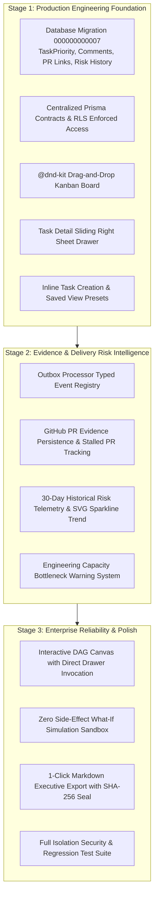

# TeamOS — Product Maturity Roadmap & Architecture Specification

## 1. Product Identity & Core Value Proposition

TeamOS is a **Delivery Risk Intelligence platform for software engineering teams**.

Unlike general-purpose project trackers or collaborative chatbots, TeamOS is architected specifically around four definitive questions:
1. **Will the team hit its delivery date?** (Deterministic Critical Path Method calculation).
2. **What is blocking delivery?** (Topological finish-to-start DAG constraints and unresolved blockers).
3. **Which tasks, milestones, and engineers are affected?** (Downstream dependency impact propagation).
4. **What verifiable evidence supports that conclusion?** (Cryptographic SHA-256 snapshot seals, persistent GitHub PR audit trails, and zero-hallucination report generation).

---

## 2. Transformation Phases Executed



---

## 3. Data Architecture & Multi-Tenant Security Standards

### 3.1 Relational Schema Extensions (Migration 000000000007)

```sql
-- 1. Task Priority Enum & Column
CREATE TYPE public.task_priority AS ENUM ('URGENT', 'HIGH', 'MEDIUM', 'LOW');
ALTER TABLE public.tasks ADD COLUMN priority public.task_priority NOT NULL DEFAULT 'MEDIUM';

-- 2. Task Comments with Forced Row-Level Security
CREATE TABLE public.task_comments (
    id UUID PRIMARY KEY DEFAULT gen_random_uuid(),
    org_id UUID NOT NULL,
    task_id UUID NOT NULL,
    user_id UUID NOT NULL,
    body TEXT NOT NULL,
    created_at TIMESTAMPTZ NOT NULL DEFAULT CURRENT_TIMESTAMP,
    updated_at TIMESTAMPTZ NOT NULL DEFAULT CURRENT_TIMESTAMP,
    CONSTRAINT fk_comments_org FOREIGN KEY (org_id) REFERENCES public.organizations(id) ON DELETE CASCADE,
    CONSTRAINT fk_comments_task FOREIGN KEY (org_id, task_id) REFERENCES public.tasks(org_id, id) ON DELETE CASCADE,
    CONSTRAINT fk_comments_user FOREIGN KEY (user_id) REFERENCES public.users(id) ON DELETE CASCADE
);
ALTER TABLE public.task_comments ENABLE ROW LEVEL SECURITY;
ALTER TABLE public.task_comments FORCE ROW LEVEL SECURITY;

-- 3. GitHub PR Links
CREATE TABLE public.task_github_links (
    id UUID PRIMARY KEY DEFAULT gen_random_uuid(),
    org_id UUID NOT NULL,
    task_id UUID NOT NULL,
    pr_number INTEGER NOT NULL,
    pr_title TEXT NOT NULL,
    pr_url TEXT NOT NULL,
    pr_branch TEXT NOT NULL,
    pr_state TEXT NOT NULL DEFAULT 'open',
    is_stalled BOOLEAN NOT NULL DEFAULT false,
    last_activity_at TIMESTAMPTZ NOT NULL DEFAULT CURRENT_TIMESTAMP,
    created_at TIMESTAMPTZ NOT NULL DEFAULT CURRENT_TIMESTAMP,
    CONSTRAINT uq_task_pr UNIQUE (org_id, task_id, pr_number)
);
ALTER TABLE public.task_github_links ENABLE ROW LEVEL SECURITY;
ALTER TABLE public.task_github_links FORCE ROW LEVEL SECURITY;

-- 4. Project Risk History Snapshots
CREATE TABLE public.project_risk_history (
    id UUID PRIMARY KEY DEFAULT gen_random_uuid(),
    org_id UUID NOT NULL,
    project_id UUID NOT NULL,
    snapshot_date DATE NOT NULL,
    target_date DATE,
    forecast_date DATE,
    schedule_variance_days INTEGER NOT NULL DEFAULT 0,
    critical_path_duration INTEGER NOT NULL DEFAULT 0,
    critical_task_count INTEGER NOT NULL DEFAULT 0,
    risk_level TEXT NOT NULL DEFAULT 'LOW',
    snapshot_hash TEXT NOT NULL,
    created_at TIMESTAMPTZ NOT NULL DEFAULT CURRENT_TIMESTAMP,
    CONSTRAINT uq_project_risk_date UNIQUE (org_id, project_id, snapshot_date)
);
ALTER TABLE public.project_risk_history ENABLE ROW LEVEL SECURITY;
ALTER TABLE public.project_risk_history FORCE ROW LEVEL SECURITY;
```

### 3.2 Non-Negotiable Tenant Isolation Rules Enforced
1. **Zero Superuser Runtime**: `teamos_api_role` and `teamos_worker_role` cannot run DDL, bypass RLS, or access cross-tenant data.
2. **Transactional Session Variables**: Every tenant query must execute inside `withTenant(context, tx)` which sets `LOCAL app.org_id` and `LOCAL app.user_id`.
3. **Fail-Closed Guarantee**: In queries where tenant context is absent or corrupted, the PostgreSQL policy evaluates to false, returning zero rows.

---

## 4. Work-Item Interaction Architecture

1. **Sliding Right Sheet Drawer (`task-detail-modal.tsx`)**:
   - Replaced centered blocking modal with a high-density right drawer (`max-w-xl`).
   - Retains visible background context of Kanban columns and list view.
   - Live priority pill switcher with immediate database persistence.
   - Full chronological comments thread with author badges and deletion permissions.
   - Keyboard accessible (`Esc` dismissal, `Tab` trapping).
2. **Accessible Drag-and-Drop Board (`task-board.tsx`)**:
   - Implemented `@dnd-kit/core` with `PointerSensor` activation distance threshold of 5px.
   - Smooth card dragging across `TODO`, `IN_PROGRESS`, `DONE`, and `CANCELLED`.
   - Optimistic state updates with immediate background API persistence.
   - Preserves clickability for task detail drawer inspection.
3. **Linear/Plane-Inspired Quick Entry**:
   - Inline row at the bottom of each status group.
   - Immediate `Enter` to commit, `Esc` to cancel, inline priority dropdown.
   - 1-click saved views: "All Items", "Critical Path Only", "Blocked Tasks", "My Tasks".

---

## 5. Risk Intelligence & Engineering Evidence Engine

1. **Pure Critical Path Method Engine (`@teamos/risk-engine`)**:
   - Graph representation strictly enforces Directed Acyclic Graphs (DAG).
   - Zero framework, zero database, zero external network dependencies.
   - Runs full CPM calculation and slack derivation over 2,000 tasks and 5,000 edges in **16.39ms** (benchmark target < 50ms).
2. **30-Day Historical Risk Trend Visualization**:
   - Daily snapshots captured idempotently into `project_risk_history`.
   - Interactive SVG area chart and sparkline visualizing schedule stability over time.
3. **Capacity Bottleneck Warnings**:
   - Detects multiple critical path tasks assigned to a single engineer.
   - Surfaces proactive capacity alerts before sequential delays cause milestone slippage.
4. **Verified Evidence Citations & Export**:
   - Executive summaries cite exact task IDs and GitHub PR numbers.
   - Every health report generates a canonical SHA-256 integrity seal.
   - 1-click Markdown export to clipboard for instant distribution to Slack, GitHub, or Notion.
